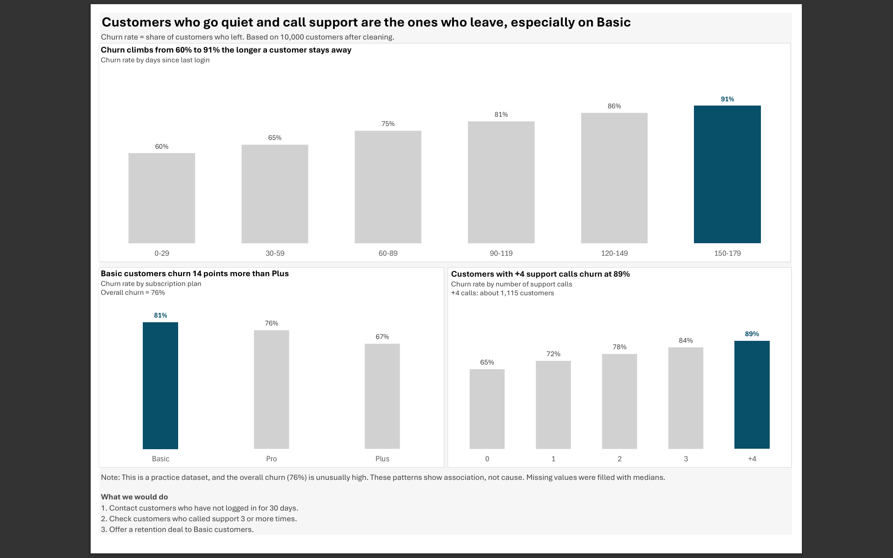

# Customer Churn Analysis (Excel + Power Query)

A practice project that takes a messy customer dataset, cleans it step by step, and presents the findings in a one-page dashboard.





## Goal

Find out which customers are most likely to leave (churn), and suggest simple actions to keep them.

## Data

* Practice dataset, 10,300 rows and 10 columns (customer details, plan, payment method, last login, support calls, monthly spend, churn).
* Source: *add where you got the dataset here*
* The dataset is not from a real company, and the overall churn rate (76%) is unusually high. The results show patterns, not proven causes.

## Tools

Excel, Power Query, Pivot Tables, Pivot Charts.

## Data cleaning

Every decision is documented in `Cleaning Log` (inside the Excel file). 

Main steps:

|Issue|Rows|What I did|
|-|-|-|
|Duplicate rows|300|Removed (10,300 to 10,000 rows)|
|Inconsistent text (`south`, `BASIC`, ...)|about 2,000|Standardized to one format|
|Impossible values (negative or very high ages, negative calls and spend, `99999.99`)|about 300|Converted to null|
|Missing values (Age, Monthly\_Spend, Customer\_Service\_Calls)|about 1,800|Filled with the median (Monthly\_Spend by plan)|
|Missing Payment\_Method|700|Filled with `Unknown`|

Why the median? It is not affected by extreme values. Why by plan for spend? Spend is very different between plans (Basic about 30, Pro about 85, Plus about 160).

## Key findings

* Churn rises from 60% to 91% the longer a customer stays away.
* Customers with 4 or more support calls churn at 89%.
* Basic customers churn 14 points more than Plus (81% vs 67%).

## Suggested actions

1. Contact customers who have not logged in for 30 days.
2. Check customers who called support 3 or more times.
3. Offer a retention deal to Basic customers.

## Files

```
data/       raw dataset
excel/      cleaned Excel file (Cleaning Log, Power Query, Pivot Tables, Dashboard)
dashboard/  dashboard as PDF and image
README.md
```

## Limitations

* Filling missing values with the median reduces variation a little.
* Zero monthly spend (1,078 customers) was kept as is, because it may be a free tier. I would confirm this with the business owner.
* Association is not cause.

